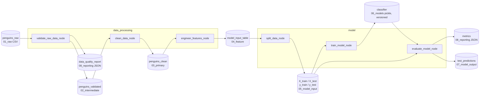

# thesis_kedro_demo — Penguin species classifier with Kedro

[](https://kedro.org)

A small, reproducible Kedro project that turns a raw CSV into a trained model
through **named catalog datasets**, **two modular pipelines** and
**configuration files** — no hard-coded paths in the Python code.

| | |
|---|---|
| **Task** | Multi-class classification — predict a penguin's **species** (Adélie, Chinstrap, Gentoo) from body measurements, island and sex |
| **Model** | `RandomForestClassifier` (scikit-learn) |
| **Outputs** | Trained model (`data/06_models/`), test predictions (`data/07_model_output/`), metrics + data-quality report (`data/08_reporting/`) |
| **Result** (default params) | Test accuracy **1.00**, macro-F1 **1.00** on 67 hold-out rows (5-fold CV ≈ 0.99 — the species are well separated, so near-perfect scores are expected, not a sign of leakage) |

---

## Dataset

**Palmer Penguins** — 344 penguins observed at Palmer Station, Antarctica (2007–2009).

* Source: <https://allisonhorst.github.io/palmerpenguins/>
* Raw CSV: <https://raw.githubusercontent.com/allisonhorst/palmerpenguins/main/inst/extdata/penguins.csv>
* Data collected by Dr. Kristen Gorman and the Palmer Station LTER.
* **License: CC0 1.0 (public domain).** Because it is public and tiny (~16 KB),
  the raw file is committed at `data/01_raw/penguins.csv` (an explicit exception
  in `.gitignore`; all generated data stays ignored).

Columns: `species, island, bill_length_mm, bill_depth_mm, flipper_length_mm, body_mass_g, sex, year`.
The raw file contains missing values (2 rows without measurements, 11 without `sex`), which the pipeline validates and cleans.

If the raw file is ever missing, re-download it with:

```bash
curl -L -o data/01_raw/penguins.csv \
  https://raw.githubusercontent.com/allisonhorst/palmerpenguins/main/inst/extdata/penguins.csv
```

---

## Project layout

```
thesis-kedro-demo/
├── conf/
│   ├── base/                 # committed, shared configuration
│   │   ├── catalog.yml       # every dataset the pipelines read/write
│   │   ├── parameters.yml    # seed, split ratio, hyperparameters, columns
│   │   └── globals.yml       # data_dir used to build catalog paths
│   ├── test/                 # 2nd environment: tiny sample + fast model
│   │   ├── globals.yml       # data_dir: data/test
│   │   └── parameters.yml    # overrides only (min_rows, n_estimators)
│   └── local/                # git-ignored: secrets / personal overrides
├── data/                     # Kedro data-engineering layers (01_raw … 08_reporting)
├── docs/pipeline.mmd         # pipeline diagram generated from the code
├── src/thesis_kedro_demo/
│   ├── pipeline_registry.py  # auto-discovers pipelines, __default__ = all
│   ├── settings.py           # soft-merge of parameters across environments
│   └── pipelines/
│       ├── data_processing/  # validate → clean → features
│       └── model/            # split → train → evaluate
├── tests/                    # pytest: node unit tests + full run in `test` env
└── .github/workflows/        # CI: pytest + kedro run on every push
```

---

## Install

Requires **Python 3.10+** (Kedro 1.x no longer supports 3.9).

```bash
git clone <your-repo-url> thesis-kedro-demo
cd thesis-kedro-demo

python -m venv .venv
source .venv/bin/activate          # Windows: .venv\Scripts\activate

pip install -r requirements.txt
pip install -e .                   # installs the project package itself
```

## Run

```bash
kedro run                               # full pipeline (data_processing + model)
kedro run --pipeline=data_processing    # only validate → clean → features
kedro run --pipeline=model              # only split → train → evaluate (needs model_input_table)
kedro run --env=test                    # tiny 36-row sample in data/test/, 10 trees
kedro run --nodes=train_model_node      # a single node
kedro run --params "model.test_size=0.3,model.random_state=7"   # override params from the CLI
```

Results after a run:

```bash
cat data/08_reporting/metrics.json              # accuracy, macro F1, per-class report, feature importances
cat data/08_reporting/data_quality_report.json  # row count, missing values, class balance
```

Tests:

```bash
pytest -q          # 5 node unit tests + 1 end-to-end run in the `test` environment
```

Inspect the pipeline interactively (optional):

```bash
kedro viz run      # opens http://127.0.0.1:4141
```

---

## Pipelines



The full diagram including parameter inputs is in [`docs/pipeline.mmd`](docs/pipeline.mmd)
(generated from the registered pipeline, so it always matches the code).

| Pipeline | Node | Inputs | Outputs | What it does |
|---|---|---|---|---|
| data_processing | `validate_raw_data_node` | `penguins_raw`, `params:data_processing` | `penguins_validated`, `data_quality_report` | Fails fast if required columns are missing, too few rows, too many NaNs, or < 2 classes |
| data_processing | `clean_data_node` | `penguins_validated`, `params:data_processing` | `penguins_clean` | Keeps required columns, lower-cases/strips text, drops NaN and duplicate rows |
| data_processing | `engineer_features_node` | `penguins_clean`, `params:model` | `model_input_table` | Adds `bill_ratio = length / depth`, one-hot encodes `island` and `sex` |
| model | `split_data_node` | `model_input_table`, `params:model` | `X_train`, `X_test`, `y_train`, `y_test` | Stratified train/test split using `test_size` and `random_state` |
| model | `train_model_node` | `X_train`, `y_train`, `params:model` | `classifier` | Fits a random forest with hyperparameters from config |
| model | `evaluate_model_node` | `classifier`, `X_test`, `y_test`, `params:model` | `metrics`, `test_predictions` | Accuracy, macro F1, per-class report, feature importances |

All nodes are pure functions (`DataFrame`/`dict` in → `DataFrame`/`dict`/model out).
They never open files — the **Data Catalog** (`conf/base/catalog.yml`) maps every
input/output name to a dataset type (`pandas.CSVDataset`, `pickle.PickleDataset`,
`json.JSONDataset`) and a relative path built from `${globals:data_dir}`.

---

## Configuration

`conf/base/parameters.yml` holds every tunable value:

| Key | Default | Meaning |
|---|---|---|
| `data_processing.required_columns` | 7 columns | Columns that must exist in the raw file |
| `data_processing.min_rows` | 100 | Minimum raw row count |
| `data_processing.max_missing_fraction` | 0.2 | Max share of NaNs allowed per column |
| `model.test_size` | 0.2 | Hold-out share |
| `model.random_state` | 42 | Seed for the split **and** the model |
| `model.stratify` | true | Keep class balance in train/test |
| `model.hyperparameters` | `n_estimators: 200, max_depth: 5, min_samples_leaf: 1` | Passed directly to `RandomForestClassifier` |
| `model.features` | numeric + categorical lists | Which columns become features |

### Environments

| Environment | How to use | What changes |
|---|---|---|
| `base` | always loaded | Full dataset in `data/`, default parameters |
| `local` (default run env) | automatic | Git-ignored; put personal overrides or credentials here |
| `test` | `kedro run --env=test` | `data_dir: data/test` (36-row sample), `min_rows: 20`, `n_estimators: 10` |

Parameters are merged with the **soft** strategy (`settings.py`), so an
environment only needs to list the keys it changes.

### Secrets

Nothing in this project needs credentials. Kedro's template keeps
`conf/local/**` and any `*credentials*` file out of Git (see `.gitignore`),
so secrets belong in `conf/local/credentials.yml` and are never committed.

---

## Reproducibility

| Item | Version used to build and test |
|---|---|
| Python | 3.13 (works on 3.10+; CI also runs 3.11) |
| Kedro | 1.7.0 |
| kedro-datasets | 9.6.0 |
| pandas | 3.0.5 |
| scikit-learn | 1.9.1 |

How results stay reproducible:

1. **Same environment** — create a fresh virtualenv and `pip install -r requirements.txt && pip install -e .`
   For an exact snapshot, freeze it once with `pip freeze > requirements-lock.txt` and reinstall later with `pip install -r requirements-lock.txt`.
2. **Same data** — the raw CSV is committed and declared in the catalog; every intermediate file is regenerated by `kedro run`.
3. **Same randomness** — `model.random_state` seeds both `train_test_split` and the random forest, so two runs with the same config give identical metrics.
4. **Traceable models** — `classifier` is a *versioned* dataset: each run saves to `data/06_models/classifier.pickle/<timestamp>/`, so older models are never overwritten.
5. **CI** — `.github/workflows/kedro-run.yml` runs `pytest`, `kedro run --env=test` and `kedro run` on every push and uploads `data/08_reporting/` as an artifact.
